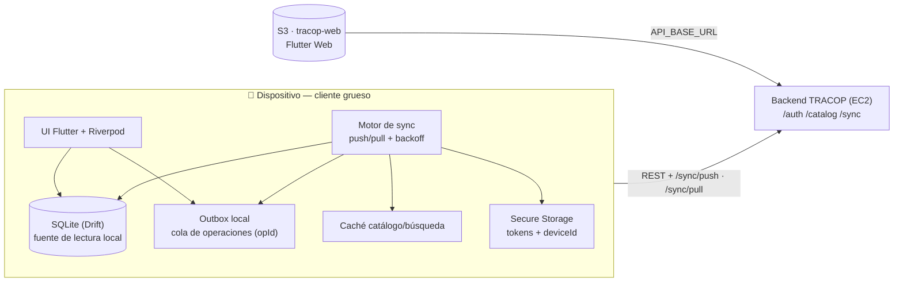

<div align="center">

# TRACOP Mobile

**Conectar la oferta agropecuaria con quienes la necesitan.**

Encontrar, comparar y gestionar productos del campo, tan simple como debería ser.


[Repositorio](https://github.com/SWNT-Tracop/Tracop-frontend) · [Contratos de integración](docs/contracts.md)

</div>

---

## El campo, sin intermediarios innecesarios

TRACOP es la aplicación para productores, proveedores y compradores del campo colombiano. Reúne la oferta que hoy vive dispersa en Telegram, redes sociales e intermediarios, y la convierte en un catálogo claro para descubrir, comparar y gestionar lotes desde el celular.

La app está pensada para la realidad del campo: conectividad inestable, poco tiempo y procesos que deben resolverse en pocos toques.


## Para quién es

| Perfil | Lo que resuelve |
| --- | --- |
| Productor | Publica su cosecha, gestiona sus lotes y mantiene su oferta al día |
| Proveedor | Organiza inventario y llega a más compradores |
| Comprador | Encuentra, compara y da seguimiento a la oferta disponible |
| Transportista | Accede a su cuenta y perfil desde el mismo ecosistema |

## Una app, tres principios

**Simple.** Pocas pantallas, textos cortos, íconos claros y cero jerga.

**Offline-first.** La app funciona sin conexión y sincroniza cuando puede.

**Confianza visible.** Cada lote muestra información suficiente para tomar una decisión.

---

## Stack

| Capa | Tecnología |
| --- | --- |
| Framework | Flutter |
| Lenguaje | Dart |
| Estado | Riverpod |
| Navegación | go_router |
| Red | dio |
| Base local | Drift + SQLite |
| Almacenamiento seguro | flutter_secure_storage |
| Conectividad | connectivity_plus |
| Ubicación | geolocator |
| Internacionalización | flutter_localizations + intl |


---

## Cómo se ejecuta

### Integración continua

GitHub Actions ejecuta `flutter analyze` y `flutter test`.

### Requisitos

- Flutter 3.x con Dart 3.x
- Xcode para iOS
- Android Studio y Android SDK para Android
- Backend de TRACOP disponible

### Instalación

```bash
flutter pub get
dart run build_runner build --delete-conflicting-outputs
```

El segundo comando genera el código de Drift para la base local.

### Ejecución

```bash
flutter run \
  --dart-define=API_BASE_URL=http://10.0.2.2:3000 \
  --dart-define=PRIVACY_POLICY_VERSION=v0-draft \
  --dart-define=ENABLE_LOCAL_MULTI_ACCOUNT=true
```

Para el simulador de iOS, usa el host del Mac:

```bash
flutter run \
  --dart-define=API_BASE_URL=http://localhost:3000 \
  --dart-define=PRIVACY_POLICY_VERSION=v0-draft \
  --dart-define=ENABLE_LOCAL_MULTI_ACCOUNT=true
```

Direcciones según el entorno:

| Entorno | `API_BASE_URL` |
| --- | --- |
| Emulador Android | `http://10.0.2.2:3000` |
| Simulador iOS | `http://localhost:3000` |
| Dispositivo físico | `http://<IP-LAN-del-backend>:3000` |

Para producción, usa una URL HTTPS.

### Builds

```bash
flutter build apk --release \
  --dart-define=API_BASE_URL=https://api.tracop.co

flutter build ipa --release \
  --dart-define=API_BASE_URL=https://api.tracop.co
```

### APK automático en cada merge a `main`

`.github/workflows/deploy.yml` corre `analyze` y `test`, compila el APK firmado y lo publica como GitHub Release `build-<n>` (`tracop-build-<n>.apk`). El número de versión sube en cada build, así que el APK nuevo se instala encima del anterior.

**Configuración del repositorio** (Settings → Secrets and variables → Actions):

| Tipo | Nombre | Valor |
| --- | --- | --- |
| Variable | `API_BASE_URL` | URL HTTPS del backend desplegado |
| Variable | `PRIVACY_POLICY_VERSION` | La misma versión que la API; si falta, `v0-draft` |
| Secreto | `ANDROID_KEYSTORE_BASE64` | El `.jks` en base64 |
| Secreto | `ANDROID_KEYSTORE_PASSWORD`, `ANDROID_KEY_ALIAS`, `ANDROID_KEY_PASSWORD` | Los de la clave |

**Crear la clave una sola vez**, fuera del repositorio y guardándola en un lugar seguro. Si se pierde, los celulares tendrán que desinstalar la app para instalar la siguiente versión.

```bash
keytool -genkeypair -v -keystore tracop-release.jks -alias tracop \
  -keyalg RSA -keysize 4096 -validity 10000
base64 -w0 tracop-release.jks   # valor de ANDROID_KEYSTORE_BASE64
```

Para firmar en local, crea `android/key.properties` (ignorado por git) con `storeFile`, `storePassword`, `keyAlias` y `keyPassword`. Sin ese archivo, `flutter build apk --release` firma con la clave debug.

### Variables de compilación

| Variable | Uso |
| --- | --- |
| `API_BASE_URL` | URL base del backend |
| `ENABLE_LOCAL_MULTI_ACCOUNT` | Muestra el selector de sesiones de prueba (solo debug; `true` para habilitarlo) |
| `PRIVACY_POLICY_VERSION` | Versión del aviso de privacidad aceptada |
| `LOG_LEVEL` | Nivel de logs de la app |

No se incluyen secretos en la aplicación. Los tokens se guardan en almacenamiento seguro y nunca se escriben en logs.

---

## Cómo se maneja

### Sesión

- El `deviceId` se genera una vez por instalación.
- El refresh token se guarda en almacenamiento seguro.
- El access token vive en memoria.
- Ante un `401`, la app renueva la sesión una vez y reintenta la solicitud.
- Si la renovación falla, se cierra la sesión y se vuelve al acceso.

### Offline

- SQLite es la fuente de lectura de la interfaz.
- Cada mutación se escribe primero en local y luego en la cola de operaciones.
- La interfaz se actualiza de inmediato.
- La cola se vacía al recuperar conexión y respeta el orden por entidad.
- Los reintentos usan espera exponencial.
- Los conflictos de versión se resuelven con la versión del servidor.

### Catálogo

- Categorías y productos se cachean para consulta rápida.
- La búsqueda consulta al servidor y guarda los resultados vistos.
- Sin conexión, se muestran los resultados cacheados con un aviso de vigencia.
- La app respeta el rate limit de búsqueda y el encabezado `Retry-After`.

### Lotes

- Crear, editar, publicar y cancelar funcionan con el modelo de estados del servidor.
- La creación usa un UUID v7 generado en el cliente, lo que evita duplicados al reintentar.
- La edición, publicación y cancelación usan `version` como control optimista.
- Un conflicto de versión se muestra al usuario para reconciliar los cambios.

---

## Estructura del proyecto

```text
lib/
├── main.dart
├── app/
│   ├── app.dart
│   ├── router.dart
│   └── bootstrap.dart
├── core/
│   ├── config/
│   ├── contracts/
│   ├── network/
│   ├── result/
│   ├── storage/
│   ├── sync/
│   └── utils/
├── features/
│   ├── auth/
│   ├── profile/
│   ├── catalog/
│   ├── lots/
│   ├── sync_status/
│   └── settings/
└── shared/
    ├── ui/
    └── widgets/
```

Cada feature separa presentación, dominio y datos. La lógica de red, almacenamiento y sincronización vive en `core`; los componentes visuales reutilizables viven en `shared`.

---

## Calidad

```bash
flutter analyze
dart format --output=none --set-exit-if-changed .
flutter test
```

Las pruebas cubren:

- Parseo estricto de contratos.
- Reglas de dinero, cantidades, fechas y UUID.
- Repositorios con base local en memoria.
- Estados de la cola de sincronización.
- Formularios, búsqueda y estados offline.
- Flujos de crear lote sin conexión, reconectar y sincronizar una sola vez.

---

## Contratos

La integración HTTP está documentada en [docs/contracts.md](docs/contracts.md): endpoints, modelos, permisos, errores, límites y ejemplos de request/response.

---

## Despliegue

La app es un **cliente grueso offline-first**: SQLite es la fuente de lectura, cada mutación se escribe primero en local y se encola, y un motor de sync hace push/pull contra el backend cuando hay conexión. En el despliegue, la app se compila contra la URL del backend (`API_BASE_URL`) y se distribuye en dos formatos: **APK** para Android y **Flutter Web** para el navegador.

### Arquitectura (cliente grueso)



- **Offline**: sin señal, la app escribe en local y actualiza la UI; al reconectar sincroniza (push idempotente por `opId`, pull por cursor).
- **Cola del servidor**: el backend procesa el push y el worker (pg-boss + outbox) ejecuta las tareas diferidas; la app descarga los cambios con `GET /sync/pull?cursor=seq`.

### Builds para la demo

```bash
# APK Android — apunta al backend desplegado (API_BASE_URL = salida `api_url` de Terraform)
flutter build apk --release \
  --dart-define=API_BASE_URL="$API_BASE_URL"

# Web — para mostrarlo en el navegador
flutter build web --release \
  --dart-define=API_BASE_URL="$API_BASE_URL"
```

- **APK**: se distribuye por descarga (GitHub Release, Drive o el propio EC2). El jurado instala el `.apk` directo.
- **Web**: se hostea en un bucket **S3** (static website hosting). Hay que configurar `CORS_ALLOWED_ORIGINS` en el backend con el origen de ese bucket.
- La web es mobile-first (cámara/ubicación quedan limitados en navegador); el APK es el camino principal.

> Sin dominio se usa HTTP tanto en el backend como en la web para evitar *mixed content*; si se agrega HTTPS, hay que aplicarlo en ambos.

### Pipeline (CI/CD)

- `.github/workflows/flutter-ci.yml` corre `flutter analyze` y `flutter test`.
- `.github/workflows/deploy.yml` compila el APK y la web, y publica ambos como artefactos; el APK queda además en un Release de GitHub. La sincronización de `build/web` al bucket S3 es manual, con las credenciales del laboratorio.

---

<div align="center">

**TRACOP** ·

</div>
